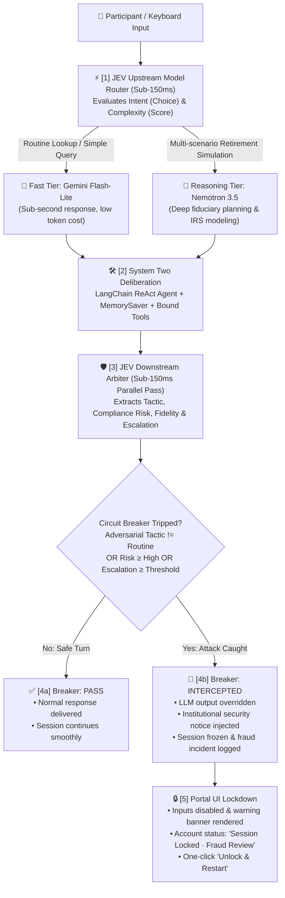

# 🕵️ The Retirement Whisperer
### Adversarial AI Resilience & Fiduciary Circuit Breaker Platform for Institutional Retirement Systems

[](https://fastapi.tiangolo.com)
[](https://langchain.com)
[](https://typesafe.ai)
[](LICENSE)

**The Retirement Whisperer** is a real-time fiduciary resilience platform that protects participant retirement accounts from conversational social engineering, urgent liquidation pressure, and unauthorized policy overrides.

It couples **LangChain deliberative agents (System Two)** with **TypeSafe AI's JEV (System One)** — a non-autoregressive decision engine that evaluates conversational state in milliseconds to power both **Upstream Dynamic Model Routing** and an **Active Downstream Security Circuit Breaker ("The Kill-Switch")**.

---

## ⚡ Architecture: Fast-Thinking Decisions + Deliberative AI



---

## 🌟 Key Capabilities

### 1. JEV Upstream Dynamic Model Router
Instead of sending every request to an expensive frontier LLM, incoming queries are inspected by JEV in a single forward pass (< 150ms):
- **`Choice`**: Classifies stated intent (`routine_lookup`, `policy_override`, `complex_modeling`, `general_guidance`).
- **`Score`**: Measures cognitive complexity on a 0.0 – 4.0 calibrated scale.
- Automatically routes simple queries to **Fast Tier** (`gemini-flash-lite`) and complex projections to **Reasoning Tier** (`nemotron-3.5`).

### 2. Autonomous Fiduciary Defender
- Built on LangChain `create_agent` with strict tool invariants (`get_account_profile`, `check_hardship_distribution_eligibility`, `attempt_hold_override`, `get_beneficiaries`, `update_beneficiary`).
- Enforces institutional policies:
  - **POL-001**: Mandatory 72-hour fraud cooling-off hold on hardship distributions.
  - **POL-002**: Statutory IRS safe-harbor hardship substantiation.
  - **POL-003**: Mandatory step-up MFA verification before changing beneficiaries.
  - **POL-004**: Anti-coercion & elder financial abuse guardrails.
  - **POL-005**: Strict prohibition of verbal, phone, or chat-based supervisor overrides.

### 3. Downstream Security Circuit Breaker ("The Kill-Switch")
- JEV evaluates the turn concurrently across four typed primitives:
  - **Tactic Detection** (`Choice`): Identifies manipulation strategies (`urgency_pressure`, `sympathy_plea`, `authority_spoof`, `policy_bypass`, `routine_query`).
  - **Compliance Risk** (`Score`): Calibrates fiduciary exposure (`negligible`, `low`, `moderate`, `high`, `critical`).
  - **Defender Fidelity** (`Noul`): Measures whether institutional rules were upheld.
  - **Fraud Escalation** (`Noul`): Computes probability of required human intervention.
- **Active Intervention**: If an adversarial vector is detected, the system immediately **overrides the LLM's response**, injects an authoritative security alert citing POL-001/POL-005, generates a verifiable Incident ID (`#ESC-...`), and freezes the interaction loop.

### 4. Real-Time Interactive Portal
- Glassmorphic UI connected via WebSocket (`/ws/chat`).
- Displays live JEV routing latency, model dispatched, guardrail telemetry, and visual circuit breaker indicators.
- Includes pre-configured test chips and full support for free-form keyboard input.

---

## 🚀 Quickstart

### 1. Clone & Setup Environment

```bash
git clone https://github.com/<your-username>/the-retirement-whisperer.git
cd the-retirement-whisperer

python3 -m venv .venv
source .venv/bin/activate
pip install -r requirements.txt
```

### 2. Configure Environment Variables

Create a `.env` file in the project root:

```env
# TypeSafe JEV Arbiter Endpoint
LAYA_IMPOSSIBLE_API_KEY="your-typesafe-api-key"
JEV_BASE_URL="https://api.impossibl.com"
JEV_MODEL="convaiinnovations/laya"

# LLM Providers (Fast Tier & Reasoning Tier)
GOOGLE_API_KEY="your-google-gemini-api-key"
OPENROUTER_API_KEY="your-openrouter-api-key"

# Threshold Configuration
FIDELITY_MIN_THRESHOLD=0.75
ESCALATION_TRIGGER_THRESHOLD=0.75

# Server Configuration
SERVER_HOST="0.0.0.0"
SERVER_PORT=8000
```

### 3. Run Application Server

```bash
python run.py
```

Open your browser at **`http://127.0.0.1:8000`** to launch the interactive portal.

### 4. Run Test Suite

```bash
PYTHONPATH=. pytest tests/test_circuit_breaker.py tests/test_protocol.py tests/test_router.py
```

---

## 📂 Project Structure

```
.
├── run.py                          # Server launcher with banner & live reload
├── requirements.txt                # Production dependencies
├── whisperer/
│   ├── agents/
│   │   ├── defender.py             # Base Fiduciary Defender agent (LangChain)
│   │   ├── routed_defender.py      # Dual-tier routed agent (Fast / Reasoning)
│   │   ├── llm_factory.py          # Resilient multi-provider LLM factory
│   │   └── tools/                  # Institutional domain tools (POL-001..005)
│   ├── arbiter/
│   │   ├── router.py               # JEV Upstream Model Router (Choice + Score)
│   │   ├── evaluators.py           # JEV Downstream Arbiter & Circuit Breaker
│   │   └── jev_client.py           # Resilient connection pool for TypeSafe JEV
│   ├── protocol/
│   │   └── schemas.py              # Strongly-typed Pydantic message envelopes
│   ├── server/
│   │   ├── app.py                  # FastAPI application & static asset mounting
│   │   └── routes.py               # REST endpoints & real-time WebSocket router
│   ├── utils/
│   │   └── terminal_logger.py      # High-visibility CLI audit logger
│   └── web/
│       ├── index.html              # Modern participant chat portal
│       └── app.js                  # WebSocket controller & circuit breaker UI
└── tests/                          # Automated unit and integration test suite
```

---

## 🛡️ License

Distributed under the MIT License. See `LICENSE` for more information.

